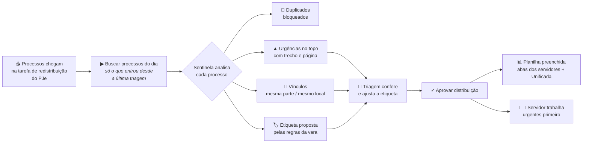

# Sentinela VEMA

**Triagem inteligente de processos para a Vara Estadual do Meio Ambiente (TJCE).**
Hackathon TJCE/UFC — Desafio 2.3.

Todo dia o Sentinela lê os processos que chegaram à VEMA, **avisa o que é urgente**,
**distribui para o servidor certo**, **mostra os casos semelhantes e o que a vara já decidiu
neles** e **preenche sozinho a planilha** que a equipe já usa, sem alterar o PJe.

**Como atende ao objetivo do desafio 2.3**

| O desafio pede | O Sentinela entrega |
|---|---|
| Organização do acervo | Triagem incremental, distribuição pelas regras da vara e planilha preenchida na aprovação |
| Identificar casos semelhantes | Vínculos por mesma parte (CPF/CNPJ) e mesmo local, mais casos com assunto semelhante |
| Padrões decisórios | O que a vara decidiu nos casos parecidos com cada processo novo, e a tela **Padrões do acervo** |
| Informações repetidas | Duplicados barrados, conduta repetida da mesma parte, fim da digitação dupla PJe → planilha |
| Eficiência e menos retrabalho | Um clique no lugar da digitação; entendimento e minutas reaproveitados |

> ⚠️ Esta demonstração usa apenas **dados fictícios** gerados por script. Nenhum dado real de processo.

## Como rodar

Pré-requisito: **Python 3.10 ou superior** ([python.org](https://www.python.org/downloads/);
no Windows, marque **"Add Python to PATH"** na instalação). Na primeira execução é preciso internet
para baixar as bibliotecas.

| Sistema | Como iniciar |
|---|---|
| **Windows** | Dois cliques em `iniciar.bat` |
| **Mac / Linux** | `sh iniciar.sh` no terminal |

O painel abre em **http://localhost:8000**. Os scripts criam o ambiente, instalam ou corrigem as
dependências e geram a base fictícia quando ela não existe. Pode rodar quantas vezes quiser.

<details>
<summary>Comandos manuais</summary>

```bash
python -m venv .venv
# Windows: .venv\Scripts\python   |   Mac/Linux: .venv/bin/python
.venv/bin/python -m pip install -r requirements.txt
.venv/bin/python scripts/gerar_dados.py               # base fictícia (sempre igual)
.venv/bin/python -m uvicorn app.main:app --port 8000
.venv/bin/python -m pytest                            # 29 testes de regras e fluxo
```
</details>

### Problemas comuns

| Sintoma | Solução |
|---|---|
| "Python 3.10 ou superior não encontrado" ou o Windows abre a Microsoft Store | Instale pelo python.org marcando **Add Python to PATH** e abra uma nova janela |
| A preparação falhou no meio (internet caiu) | Rode o script de novo; ele completa o que faltou. Se persistir, apague a pasta `.venv` |
| "Address already in use" / porta 8000 ocupada | Feche outra instância do Sentinela ou troque `--port 8000` por outra porta |
| "A planilha está aberta em outro programa" ao aprovar | Feche o arquivo no Excel e clique em **Aprovar distribuição** de novo; nada foi gravado |
| Quero voltar a demo ao início | Ícone **↺** no menu lateral (Reiniciar demonstração) |

## O problema (entrevista com a VEMA, 05/10/2026)

| Dor relatada | Como o Sentinela resolve |
|---|---|
| Planilha preenchida 100% à mão, inclusive em duplicidade (aba do servidor + Unificada) | Gera as linhas automaticamente, nas duas abas, no formato atual |
| Fila acumula quando falta gente; extração do painel PED não é incremental | Extração incremental: só o que entrou desde a última triagem aprovada |
| Tutela de urgência de 48h ficou 20 dias parada na fila | Detector de urgência com trecho e página da petição como prova |
| Etiqueta de "réu preso" errada após a migração | Confere a etiqueta contra o texto e sinaliza divergência |
| Processo repetido ou perdido na planilha | Bloqueia duplicados e valida o dígito verificador CNJ |
| Distribuição manual com regras (pesos, apensos, par/ímpar) | Distribuidor com as regras da vara, configurável |
| "Já esqueci o que fiz na semana passada" (mais de mil processos) | Vínculos por mesma parte e mesmo local + casos semelhantes |
| Cada servidor decide casos parecidos sem ver o que os colegas já decidiram | Padrão decisório da vara ao lado de cada processo e por assunto |

## Um dia de trabalho na VEMA com o Sentinela

Quem usa:

| Papel | Quem é hoje | O que faz no Sentinela |
|---|---|---|
| **Triagem** | Estagiária de pós-graduação ou gestora da secretaria | Busca os processos do dia, confere e aprova a distribuição |
| **Servidor / assistente** | Equipe que recebe os processos (a "etiqueta") | Abre os processos recebidos, começando pelos urgentes, e usa os vínculos na análise |
| **Gestão** | Diretora de secretaria / magistrado | Acompanha carga por servidor, duplicados e auditoria |



### 1. Início do expediente: buscar o que chegou

**Quem:** triagem · **Tempo:** segundos (antes: abrir processo por processo)

1. Na tela inicial, o painel **Triagem do dia** mostra quando foi a última triagem aprovada.
2. Escolha o **modo de distribuição**:
   - **Equilibrado**: rodízio que iguala a carga, considerando que quem trabalha 3 dias recebe menos;
   - **Par / ímpar**: divide pelo dígito verificador do número do processo.
3. Clique em **Buscar processos do dia**. O Sentinela lê a tarefa *Distribuição - Redistribuição - Analisar distribuição* e traz **somente** o que entrou depois da última triagem. Nada se repete, mesmo se a fila ficou dias sem ser olhada.

O painel **Resumo da triagem** mostra na hora quantos processos chegaram, quantos têm alerta, quantos duplicados foram barrados e quantos têm vínculos.

### 2. Olhar primeiro o que não pode esperar

**Quem:** triagem · **Antes:** a urgência só aparecia quando alguém lia o PDF, e uma tutela de 48h ficou 20 dias parada.

A lista de processos já vem **ordenada por prioridade**, com uma pílula colorida em cada card:

| Pílula | Significado | O que fazer |
|---|---|---|
| 🔴 **▲ Tutela/liminar** | Pedido de urgência (prazo de 48h) | Avisar o servidor da etiqueta no mesmo dia |
| 🟠 **◆ Réu preso** | Há pessoa presa no processo | Priorizar e acompanhar a revisão a cada 90 dias |
| 🟡 **● Idoso** | Prioridade legal de tramitação | Tramitar com prioridade |
| ⬜ **? Réu preso (conferir)** | O PJe diz "réu preso", mas a petição não confirma | Conferir a etiqueta, que pode ser erro da migração |

Ao clicar no card, o painel da direita mostra **o trecho exato da petição e a página** que geraram o alerta, com link direto para o PDF. A triagem confere em segundos, sem ler o processo inteiro.

### 3. Conferir a etiqueta de cada processo

**Quem:** triagem · **Antes:** decidir de cabeça para quem vai e contar na planilha quantos cada um já tem.

Cada card já chega com a **etiqueta azul do servidor proposto** e uma linha **SENTINELA:** explicando o motivo:

- *"Dependente do processo 2908107-55…, que está com Bruno"*: apensos ficam com quem tem o principal;
- *"rodízio ponderado (carga 33, peso 1)"*: quem tinha menos processos recebeu.

O painel **Carga por servidor** mostra o acervo de cada um (azul) e o que está entrando hoje (laranja). Para mudar alguém, basta **clicar na etiqueta e escolher outro servidor**. A mudança fica registrada na auditoria.

A aba **Duplicados** lista o que foi barrado: *"Já distribuído para Elisa"*. Ninguém digita o mesmo processo duas vezes.

### 4. Aprovar e deixar a planilha pronta

**Quem:** triagem · **Antes:** digitar número, sistema, classe e data na aba do servidor **e de novo** na aba Unificada.

1. Clique em **Aprovar distribuição**. Só aqui algo é gravado; até esse momento tudo é proposta.
2. A planilha **01 - Controle de Acervo** é atualizada automaticamente:
   - cada processo entra na **aba do seu servidor** e na aba **Unificada - Controle**;
   - as colunas de sempre (Quant., Processos, Sistema, Classe, Data do recebimento) vêm preenchidas;
   - duas colunas novas aparecem: **Urgência** (colorida) e **Vínculos**;
   - as colunas de cada servidor (**Providência, Última análise, Observação**) continuam livres, do jeito que cada um já trabalha.
3. Na próxima busca, o Sentinela começa a partir deste ponto.

### 5. O servidor trabalha seus processos

**Quem:** servidor / assistente · **Antes:** "quando encontro a Maria de novo, já esqueci o que fiz semana passada".

1. O servidor vê seus processos na planilha, como já faz hoje, ou no **Acervo distribuído**, filtrando pelo próprio nome.
2. Ao abrir um processo, logo abaixo da prioridade, encontra **Casos semelhantes e o que a vara decidiu**:
   - o **padrão**: *"Em 5 de 6 casos parecidos já decididos, a vara decidiu: Liminar deferida"*, com a distribuição das decisões;
   - **Mesma parte ou mesmo local**: mesma parte (pelo CPF/CNPJ, mesmo com o nome escrito diferente) ou mesmo local (ex.: *Lagoa da Parangaba*), com o nome de quem está com cada um;
   - **Assunto semelhante**: casos parecidos, para reaproveitar entendimento e minutas;
   - em cada caso relacionado, **a decisão registrada**, a data e o resumo;
   - mais abaixo, a **síntese dos fatos**, extraída da petição, e o link para o PDF.
3. Com isso, a conduta repetida (o 4º processo da mesma pessoa por maus-tratos) e os conflitos do mesmo território aparecem **antes** da análise, não por acaso.

### 6. Acompanhamento da gestão

**Quem:** gestão

- **Carga por servidor**: se a divisão está igualitária, respeitando quem trabalha 3 dias.
- **Padrões do acervo** (ícone da balança): para cada assunto, como a vara costuma decidir, em quanto tempo e as decisões mais recentes. Clicar numa decisão abre a lista desses processos.
- **Acervo distribuído**: busca por número, classe, parte ou local, com filtros por servidor, **assunto** e **decisão**.
- **Auditoria**: quem buscou, quem mudou etiqueta, quem aprovou e quando.

### Antes e depois

| Etapa | Hoje | Com o Sentinela |
|---|---|---|
| Ver o que chegou | Abrir a fila e conferir processo por processo | Um clique, só o que é novo |
| Achar urgências | Ler o PDF (ou não ver) | Pílula no topo + trecho da petição |
| Distribuir | Contar de cabeça e etiquetar | Etiqueta proposta pelas regras da vara |
| Evitar repetidos | Torcer para lembrar | Duplicados bloqueados automaticamente |
| Planilha | Digitar duas vezes | Preenchida na aprovação |
| Lembrar casos ligados | Memória de cada servidor | Vínculos mostrados ao abrir o processo |
| Saber como a vara decide | Perguntar a um colega ou procurar minutas antigas | Padrão decisório ao lado do processo |

> **O Sentinela nunca decide sozinho.** Ele propõe, mostra a prova e o motivo, e uma pessoa aprova.

## Como funciona

```
 PJe (JBoss Seam) ──MNI/SOAP──▶ Conector PJe ──▶ Núcleo Sentinela ──▶ Planilha (Teams/Graph)
   [simulado no MVP]                              │  1. Deduplicação + validação CNJ
                                                  │  2. Detector de urgência (regras + metadados)
                                                  │  3. Distribuidor (regras da vara)
                                                  │  4. Vínculos (partes, locais, similaridade)
                                                  │  5. Padrões decisórios (decisões registradas)
                                                  ▼
                                      Banco + Painel web (aprovação humana)
```

**Princípios**
- **Zero alteração no PJe.** Integração pelo MNI, padrão de interoperabilidade do CNJ.
- **Humano no controle.** Nada é gravado sem aprovação; toda ação fica na auditoria.
- **Explicável.** Cada alerta traz o trecho e a página; cada distribuição e cada vínculo trazem o motivo.
- **Dados dentro do tribunal.** Sem envio de autos para serviços externos; a fase 2 usa modelo de IA local.
- **Peças trocáveis.** Conectores com interface única: trocar o PJe simulado pelo MNI real
  ou o `.xlsx` pela planilha do Teams é configuração.

## Estrutura

```
app/
  config.py            servidores, pesos e modo de distribuição (regras ajustáveis pela gestão)
  cnj.py               número único CNJ: validação, dígito verificador, paridade
  urgencia.py          detector de tutela/liminar, réu preso e idoso, com evidência
  distribuidor.py      rodízio ponderado, apensos, modo par/ímpar
  vinculos.py          mesma parte (CPF/CNPJ), mesmo local, assunto semelhante
  padroes.py           padrão decisório dos casos parecidos e quadro por assunto
  servico.py           fluxo: extrair → deduplicar → analisar → propor → aprovar
  planilha.py          "01 - Controle de Acervo": acrescenta linhas sem apagar anotações
  repositorio.py       persistência (SQLite no MVP; PostgreSQL + pgvector na fase 2)
  conectores/          PJe simulado (MVP) e PJe via MNI (fase 2)
  main.py              API FastAPI + painel
web/                   painel (HTML/CSS/JS)
scripts/gerar_dados.py base fictícia com os casos do roteiro
tests/                 regras críticas, fluxo completo e padrões decisórios
iniciar.bat / .sh      sobe tudo com um comando (Windows / Mac e Linux)
```

## Roteiro da demonstração (3 min)

1. **Contexto:** "Na VEMA, uma tutela de urgência de 48 horas ficou 20 dias parada na fila."
2. Clicar **Buscar processos do dia**: 33 novos, 4 duplicados bloqueados, 7 com alerta.
3. Abrir a **tutela da Lagoa da Parangaba**: trecho e página da petição; mesma empresa
   já tem 2 processos na vara; outros processos no mesmo local.
4. Mostrar o **"Réu preso (conferir)"**: a etiqueta do PJe não bate com o texto.
5. Mostrar o **pedido de relaxamento de prisão**: foi para o mesmo servidor do processo principal.
6. Abrir o caso da **Maria do Socorro**: 4º processo por maus-tratos, conduta repetida.
7. Voltar à tutela da Lagoa: **"Em 5 de 6 casos parecidos, a vara deferiu a liminar"**, com as decisões
   anteriores da mesma empresa. Abrir **Padrões do acervo** e clicar em *Poluição → Liminar deferida*.
8. **Aprovar distribuição** e abrir a **planilha**: abas preenchidas, coluna de urgência colorida.

## Próximos passos (até o Demo Day e após aprovação)

- [ ] Conector real via **MNI** (Java/JAX-WS, stack da TI do TJCE)
- [ ] Escrita direta na planilha do Teams via **Microsoft Graph**
- [ ] **PostgreSQL + pgvector** e embeddings **BGE-M3** para busca semântica
- [ ] **Modelo de linguagem local** (Ollama) para confirmar urgências e resumir peças longas
- [ ] OCR para PDFs digitalizados; alerta de revisão de prisão a cada 90 dias
- [ ] Card do Sentinela dentro do painel do PJe
- [ ] Login integrado ao do tribunal (o MVP não tem autenticação) e perfis triagem / servidor / gestão
- [ ] Ler as decisões reais da coluna **PROVIDÊNCIA** da planilha e dos movimentos do PJe (no MVP, as decisões são fictícias)

### Implementações futuras para aprofundar o desafio 2.3

- [ ] **Informações repetidas no painel:** ranking das partes e dos locais que mais se repetem no acervo
  (condutas reincidentes, territórios como a Lagoa da Parangaba), com alerta quando um novo processo entra nesse grupo.
- [ ] **Análise do acervo inteiro:** busca por similaridade em todos os processos, inclusive os antigos
  (hoje vínculos e casos semelhantes são calculados para os processos que chegam na triagem).
- [ ] **Medidor de retrabalho evitado:** linhas da planilha que não precisaram ser digitadas,
  duplicados barrados e decisões reaproveitadas, por dia e por mês.
